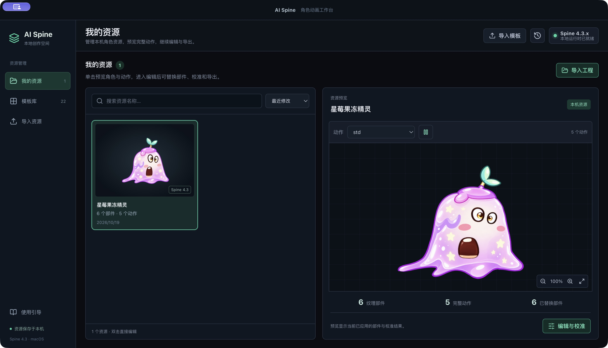

# AI Spine

AI Spine 是一个本地 Spine 角色动画创作工作台，提供 macOS 桌面应用和本地网页界面，将模板管理、AI 形象与部件生成、部件替换、校准、动画预览和资源导出连接为完整的创作流程。

## 主要功能

### 资源管理

- 内置 22 个角色动画模板，支持按类型、分类和名称查找。
- 资源库提供缩略图、名称搜索、最近修改与名称排序。
- 选择资源即可查看大幅动画预览、动作列表、部件数量和替换状态。
- 工程自动保存到本机，可从资源库继续编辑。

### 部件替换与校准

- 在动画画面中拾取部件，或从部件列表中搜索、选择纹理区域。
- 使用 PNG、JPEG 或 WebP 替换部件图片，透明 PNG 可保留独立部件的轮廓。
- 支持位置、缩放、旋转、水平与垂直镜像，以及按模板透明轮廓适配。
- 校准窗口提供参考叠图、实际输出范围、键盘微调和撤销、重做。
- 支持 Atlas 多贴图页、90° 旋转区域、裁切偏移和预乘透明度。

### 动画预览

- 使用 Spine 4.3 运行库播放真实骨骼动画，支持加权网格、约束、路径、裁剪和多皮肤。
- 支持动作与皮肤切换、播放与暂停、速度调整、时间轴定位、缩放和平移。
- 编辑器提供当前角色放大视图，以及原模板与当前角色同步播放的对照视图。
- 部件列表与骨骼显示辅助检查关节、遮挡和图片连接位置。

### AI 创作

- 通过本机已登录的 Codex 账号生成角色形象和透明部件图片。
- 支持生成或导入形象参考，并结合模板姿势、原始部件和文字描述逐件生成。
- 提供生成进度、取消、候选预览、下载和记录恢复。
- 候选确认后可单件或批量应用，继续使用同一套校准、预览和导出流程。
- 形象参考、提示词、已应用图片和校准参数随可编辑工程保存。

### 导入与导出

- 导入 ZIP，或同时选择 JSON / SKEL 骨架、Atlas 与全部贴图。
- 导出 Spine 运行时资源包，包含骨架、Atlas 和校准后的贴图。
- 导出可编辑工程备份，保留原始文件、替换图片、校准参数与 AI 形象参考，可重新导入继续制作。
- 贴图修改烘焙回原 Atlas 区域，保留原始骨架、网格权重、变形时间线、事件、皮肤及动作数据。

## 桌面工作台

macOS 桌面应用提供独立窗口、资源导航栏、原生菜单、文件选择与保存对话框。应用自动启动本机服务，关闭前保存当前工程，重新打开后可继续浏览和编辑。

双击项目中的 `启动桌面工作台.command`，或打开构建后的 `outputs/desktop/AI Spine.app`。桌面应用包含模板库和完整的「星莓果冻精灵」示例工程；该角色具有 6 个独立替换部件和 5 个动作。

## 创作流程

1. 选择模板或导入 Spine 资源。
2. 生成角色形象，或导入已有形象作为参考。
3. 生成并确认部件候选，也可手动替换图片。
4. 调整每个部件的位置、比例与连接关系。
5. 切换动作，检查角色整体效果和模板对照。
6. 保存工程，导出运行时资源或可编辑备份。

## 资源格式

| 类型 | 支持内容 |
| --- | --- |
| 骨架 | Spine 4.3.x JSON、SKEL 运行时资源 |
| 图集 | Atlas，多贴图页、旋转区域与裁切偏移 |
| 替换图片 | PNG、JPEG、WebP |
| 导入包 | 包含骨架、Atlas 与贴图的 ZIP |
| 运行时导出 | 骨架、Atlas 与烘焙后的 PNG |
| 可编辑备份 | 原始资源、替换图、校准参数、形象参考与提示词 |

部件的输出范围由原 Atlas 区域与网格决定。运行时资源应使用匹配的 Spine 4.3 运行库；`.spine` 编辑器工程不属于当前导入格式。

## 本地数据

桌面工程保存在 `~/Library/Application Support/AI Spine`，网页工程保存在当前浏览器的 IndexedDB。两种界面之间可通过可编辑 ZIP 备份传递工程。

AI 生成由本机 Codex App Server 执行，账号认证和续期由 Codex 管理。生成输入、结果和工程数据保存在本机；提交生成任务时，描述与参考图片会交给 Codex 生图服务处理。

## 技术组成

| 模块 | 技术 |
| --- | --- |
| 界面 | React 19、Vite 6、Lucide |
| 桌面应用 | Electron、macOS 原生菜单与文件对话框 |
| 动画运行时 | Spine WebGL 4.3 |
| 图片处理 | Canvas、@napi-rs/canvas |
| 资源包处理 | fflate、Web Worker |
| 工程存储 | IndexedDB |
| AI 生成 | 本地 Codex App Server、原生图像生成工具 |

## 项目结构

| 目录 | 内容 |
| --- | --- |
| `src/components/` | 资源库、动画预览、部件校准与 AI 创作界面 |
| `src/core/` | 资源包处理、图像处理、工程存储与生成适配 |
| `src/spine/` | Spine 运行时加载、动画取景与部件拾取 |
| `desktop/` | 桌面启动、窗口、菜单和本机生产服务 |
| `server/` | Codex 连接、生成任务队列和结果校验 |
| `public/templates/` | 模板目录、骨架、图集与贴图 |
| `scripts/` | 本地启动与构建工具 |
| `tests/` | 资源、运行时、生成服务与桌面功能测试 |
| `docs/` | 使用、构建与功能说明 |

## 相关文档

- [桌面应用与构建](docs/desktop.md)
- [AI 生成流程](docs/generation.md)
- [资源与功能验证](docs/validation.md)
- [完整角色示例](outputs/egg-starberry/README.md)
- [第三方依赖与素材说明](THIRD_PARTY_NOTICES.md)
