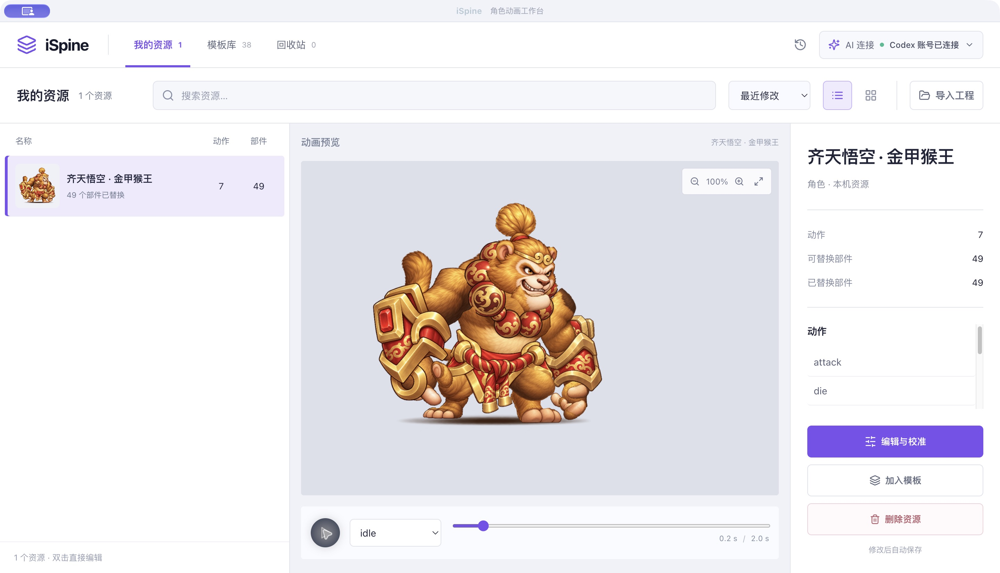
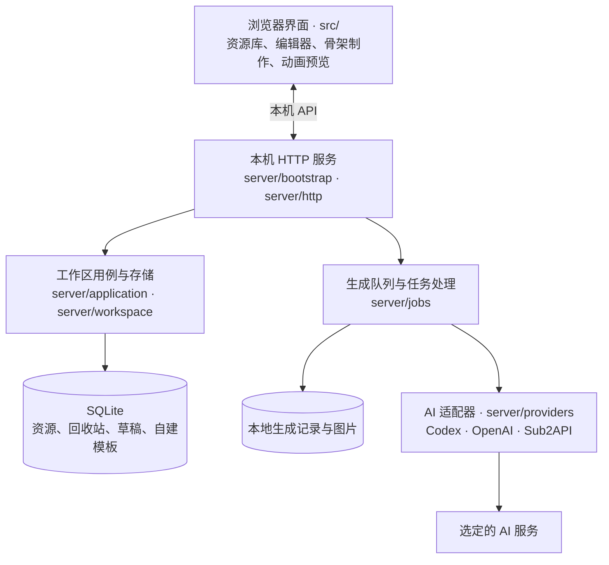

# iSpine

iSpine 是在浏览器中使用的本地 Spine 角色动画创作工作台。它支持沿用模板制作角色，也支持从 Q 版立绘创建独立人形骨架，提供 AI 分析与补绘、部件校准、绑定、动作制作、真实动画预览和资源导出。

浏览器负责交互、预览与素材处理，本机 Node.js 服务统一管理资源和生成任务，SQLite 保存工程数据。同一台电脑的不同浏览器共用资源库；AI 请求使用用户明确选择的服务。

## 主要功能

### 资源管理

- 内置 38 个动画模板，包含 37 个角色和 1 个技能特效。
- 模板列表上方提供常驻的类型与分类筛选，可直接选择「角色 → 人物 / 怪物」或「特效 → 法术」。
- 使用浅色三栏资源浏览界面：左侧资源列表，中间动画预览，右侧详情与操作；支持列表 / 网格、名称搜索、最近修改与名称排序。
- 模板库提供 1 列列表与固定 3 列纯图片两种排列；图片缩略图位于紧凑的左栏，中间保留大幅动画预览，右侧查看名称、动作数和部件数。
- 在「我的资源」选择资源，点击「加入模板」，设置名称、类型和分类后保存；在模板库的「我创建的」中查看并创建新角色或特效。当前部件替换和校准效果会固化为独立模板，同一资源再次保存会更新原模板。
- 选择资源即可查看大幅动画预览、动作列表、部件数量和替换状态。
- 独立骨架分别统计逻辑部件、附件变体、骨骼、动作区域、特效层及纹理区域，特效序列帧不计为身体部件。
- 工程和自建模板保存在本机，可从资源库继续编辑；后续修改或删除原资源不会改变已保存的模板。自建模板可单独删除。
- 从模板新建时先打开临时草稿；仅预览或打开 AI 创作后返回，不会新增资源。修改内容、填写创作描述、应用形象或部件后自动保存，也可主动保存或导出。
- 保存按资源串行执行，连续编辑合并为最新待写内容；切页等待确认保存。版本冲突保留本地修改，可另存为新资源。
- 原始图片按内容复用，改名、校准和关键帧编辑不重复上传未变素材；保存响应中断后使用原提交标识恢复。资源列表独立读取摘要，选中时再加载图片与工程。
- 支持移入回收站、恢复、永久删除和清空回收站。永久删除前需要确认，删除后无法恢复。

### 部件替换与校准

- 在动画画面中拾取部件，或从部件列表中搜索、选择纹理区域。
- 使用 PNG、JPEG 或 WebP 替换部件图片，透明 PNG 可保留独立部件的轮廓。
- 支持位置、缩放、旋转、水平与垂直镜像，以及按模板透明轮廓适配。
- 校准窗口提供参考叠图、实际输出范围、键盘微调和撤销、重做。
- 模板的单个刚性部件可作为命名变体应用到指定动作，例如受击、战败时切换痛苦表情；其他动作恢复默认部件。变体支持独立校准、撤销和随工程导出回导。
- 支持 Atlas 多贴图页、90° 旋转区域、裁切偏移和预乘透明度。

### 动画预览

- 使用 Spine 4.3 运行库播放真实骨骼动画，支持加权网格、约束、路径、裁剪和多皮肤。
- 支持动作与皮肤切换、播放与暂停、速度调整、时间轴定位、缩放和平移。
- 同一皮肤的全部动作共用预览比例与位置，切换动作时保留手动缩放和平移。
- 编辑器提供当前角色放大视图，以及原模板与当前角色同步播放的对照视图。
- 部件列表与骨骼显示辅助检查关节、遮挡和图片连接位置。

### 独立骨架与动作

- 在「我的资源」点击「新建角色」，先填写身份、比例、镜头、持握、固定约束和交付要求，并为每个动作写明脚本、表情、接触与终态。制作计划默认包含 idle / attack / death，可调整实际制作范围。
- 计划确认后，生成或上传完整 Q 版设定图与动作关键图，逐图审阅后才规划角色自己的结构。确认记录绑定当前文字和图片；改动会要求重新审阅相关阶段，原图与已制作内容保留。
- 拖动关节修正位置，调整部件的坐标、层级与绑定；独立部件可上传透明图片，或让 AI 补绘被遮挡的部分。
- 结构分析提供标准与精细拆分；精细档按活动边界规划 24–40 个部件、最多 64 个，双手、前臂、发束、衣摆和武器可独立制作。补绘保留原生候选并按比例适配，部分失败可沿原任务继续生成未完成部件。
- 在骨架工作台直接校准独立图片的大小、位置、旋转和镜像，按立绘参考调整透明边距与拼接位置，再检查真实动画。
- 使用原图像素网格和部件轮廓建立坐标对应，保留可见衣服、四肢与脸部的原始轮廓；AI 图片用于隐藏表面。应用前可查看叠图、像素归属、轮廓覆盖与色彩误差，矩形不足时明确扩框并保留已有图片比例。
- 硬质部件采用刚性绑定，柔性部件采用加权网格；支持规则网格密度与逐顶点权重调整。
- 按描述制作待机、攻击、受击及其他动作，编辑关键帧、关节角度、根位移、节奏和脚锁；仅重新生成选中动作，保留已经修正的绑定。
- 动作预设提供跑步、技能、死亡与胜利，可设置动作描述并生成关键姿势，也可添加自定义动作。
- 动作工作台可用程序生成跟随杖头与施法手的蓄力、释放魔法特效，独立调整时间、位置、强度与叠加方式。特效只在所属动作显示，透明纹理、附件时间轴与程序来源随 Spine 资源导出，身体关键帧保持独立。
- 相邻肢体可用现有图片按原坐标合成当前动作专用的连续网格，用于处理弯曲时的贴图拼接断口；原分件、其他动作与制作来源保留，支持撤销和导出回导。此操作属于贴图合成，隐藏面仍需单独补绘。
- 眼睛、眉毛、嘴型及手型可拆成独立附件，并在显示组中新增变体。每组设置默认图，在关键帧切换、隐藏或沿用；表情切换随 Spine 动作和作者工程一起保存。
- 每个部件可查看「动作时间 → 网格位置」及隐藏时段，一键暂停定位到 32 像素网格，显示当前部件中心与所在行列。
- 完整重叠部件逐件审阅隐藏接头及原图归属；脸底和五官保留独立底图，其他部件可选择保留已审源像素或仅用完整底图。应用前查看真实重组与像素差异。
- 动作原画可作为连续骨骼规划的姿势参考，或逐张对应关节、可见部件及遮挡后使用原画切片。两种播放用途独立，原画、审阅及来源随工程保存；仅应用选定动作，保留原待机和基础部件。
- 程序计算骨骼坐标、网格权重、双骨脚锁与双手武器握点，并将动作烘焙为 Spine 关键帧。预览可检查脚滑、握点误差和循环衔接。
- 草稿自动独立保存，尚无图片的已写制作计划也可恢复。启用制作计划的角色在部件、绑定与各动作审阅完成后，先下载运行时和可编辑验收包，再回导实际文件比对骨架、Atlas、PNG 与作者数据；通过数值检查后保存普通资源。
- 自建骨架资源可进入「手动调整」：在基准姿势选中部件，拖动金色手柄、用方向键微调或输入 X/Y，支持等比缩放、遮挡层级和撤销 / 重做。原始图片和已有动作保留；调整后的部件位置由各动作继承。

详细操作见 [角色制作工作流](docs/character-production-workflow.md) 与 [新骨架与动作](docs/rig-authoring.md)。

### AI 创作

- 通过本机已登录的 Codex 账号生成角色形象和透明部件图片。
- 提供独立的「AI 连接」入口和连接状态，默认使用 Codex，也可选择 OpenAI API 或自己的 Sub2API 网关。Sub2API 支持 GPT Image 与 Gemini 原生图片接口、自定义模型和参考图编辑。
- 服务、模型与任务绑定，失败时保持原选择，不自动切换提供方。连接设置与网关配置见 [AI 连接说明](docs/ai-connections.md) 和 [Sub2API 网关](docs/sub2api.md)。
- 支持生成或导入形象参考，并结合模板姿势、原始部件和文字描述逐件生成。
- 提供生成进度、取消、候选预览、下载和记录恢复。
- 候选确认后可单件或批量应用，继续使用同一套校准、预览和导出流程。
- 形象参考、提示词、已应用图片和校准参数随可编辑工程保存。

### 导入与导出

- 导入 ZIP，或同时选择 JSON / SKEL 骨架、Atlas 与全部贴图。
- 导出 Spine 运行时资源包，包含骨架、Atlas 和校准后的贴图。
- 导出 Unity 资源包，整理 `.atlas.txt` / `.skel.bytes` 扩展名，并附版本、透明度与导入说明。
- 导出可编辑工程备份，保留原始文件、替换图片、校准参数与 AI 形象参考，可重新导入继续制作。
- 模板替换将贴图修改烘焙回原 Atlas 区域，保留原始骨架、网格权重、变形时间线、事件、皮肤及动作数据。
- 独立骨架导出当前绑定、动作、附件切换与特效时间轴，并保留制作计划、来源和可编辑骨架数据；独立 PNG 与 `skeleton.images` 路径随包提供。

## 本机网页工作台

浏览器提供完整资源库、校准、骨架编辑、AI 创作和导出功能。本机后台统一保存工程，Chrome 与内置浏览器读取同一份资源和生成记录。窄窗口采用列表与预览之间的前进、返回操作。

打开 [本机工作台](http://127.0.0.1:4175)，或双击项目中的 `启动工作台.command`。当前 Mac 登录后自动启动后台，关闭网页不会丢失资源。同机使用无需域名或额外服务器。运行与数据说明见 [本机网页工作台](docs/workbench.md)。

## 创作流程

独立角色按「计划与约束 → 造型与分镜 → 结构与关节 → 拆分与补绘 → 绑定与权重 → 动作与关键帧 → 验证与保存」制作，不复用模板骨架。关键图指导连续动作；视觉审阅与数值检查分别通过后，再完成实际导出回导。

模板角色按以下流程制作：

1. 选择模板或导入 Spine 资源。
2. 生成角色形象，或导入已有形象作为参考。
3. 生成并确认部件候选，也可手动替换图片。
4. 调整每个部件的位置、比例与连接关系。
5. 切换动作，检查角色整体效果和模板对照。
6. 保存工程，导出运行时资源或可编辑备份。

编辑器和 AI 创作窗口均显示创作流程，可直接切换到对应步骤。确认形象后，点击「使用此形象 → 制作全部部件」选择整个模板；部件默认同时生成 3 张，可选择 1–4 张，实时显示进行中的部件。候选图确认后应用到资源，并自动按模板轮廓初步适配。生成中可返回编辑器，稍后继续查看进度；取消会停止当前批次的全部生成。中断或失败的记录可调整并行数量，继续生成剩余部件，保留已完成的候选以及原来的描述和参考图。校准与动作检查需在预览中完成。

独立角色的视觉审阅与数值检查分别记录。姿态、表情、肢体遮挡和动作节奏需要逐动作检查，数值通过不能代替视觉确认。

## 资源格式

| 类型 | 支持内容 |
| --- | --- |
| 骨架 | Spine 4.3.x JSON、SKEL 运行时资源 |
| 图集 | Atlas，多贴图页、旋转区域与裁切偏移 |
| 替换图片 | PNG、JPEG、WebP |
| 导入包 | 包含骨架、Atlas 与贴图的 ZIP |
| 运行时导出 | 骨架、Atlas、PNG；独立骨架包含附件切换与特效时间轴 |
| Unity 导出 | JSON / SKEL.bytes、Atlas.txt、PNG 与导入说明 |
| 可编辑备份 | 原始资源、替换图、校准参数、形象参考与提示词；独立骨架包含作者文档、制作计划与审阅记录 |

模板替换的输出范围由原 Atlas 区域与网格决定；独立骨架按当前部件与附件生成图集。运行时资源应使用匹配的 Spine 4.3 运行库；`.spine` 编辑器工程不属于当前导入或直接导出格式。

Unity 资源包用于已安装匹配版本 spine-unity 的 Unity 工程。官方 Spine 编辑器可通过 Import Data 导入骨架，再保存为 `.spine`；原始数据未包含的编辑信息无法完整恢复。在 iSpine 中继续调整图片、校准、独立骨架和动作，可重新导入可编辑工程备份。具体导入条件见 [Unity 导出与 Spine 编辑说明](docs/unity-export.md)。

## 本地数据

正式工作台的数据根目录为 `~/Library/Application Support/AI Spine`：

| 内容 | 根目录下的位置 |
| --- | --- |
| 工程、回收站、删除标记、骨架草稿、自建模板 | `workspace/workspace.sqlite` |
| 生成输入、候选与任务记录 | `generation/jobs/` |
| 加密 AI 连接配置 | `generation/jobs/.connection/connection.json` |
| 后台日志 | `logs/` |

资源列表使用独立摘要索引和按需缩略图，打开具体资源时才读取完整工程。原始素材按内容去重，草稿、模板和正式资源保持独立生命周期。保存带版本检查，冲突时保留本地编辑；后台不可用时明确报告失败，不自动改存到另一份浏览器数据库。可编辑 ZIP 用于独立备份与跨电脑传递，数据恢复与兼容导入见 [本机网页工作台](docs/workbench.md)。

点击顶部的「AI 连接」进行设置。Codex 方式识别本机已登录的 ChatGPT 账号，并提供安装与登录指引；API Key 方式提供密钥输入、模型选择和连接验证。Sub2API 另提供服务地址、图片接口与自定义模型设置，上游账号在网关后台授权。顶部显示当前 AI 服务的连接状态。

Codex 的账号认证和续期由 Codex 管理。本机后台使用系统安全存储保护用户选择记住的 API Key；启动、浏览资源和默认 Codex 连接无需解锁钥匙串，显式 API 验证或生成才按需解锁。不支持系统保护的环境仅在本次运行中保留 Key。密钥与角色工程分开保存，不写入导出 ZIP。生成任务固定使用提交时选择的服务与模型，失败后可手动继续；API 用量由对应 API 账户结算。

生成输入、结果和工程数据保存在本机；点击生成后，描述与参考图片会提交至用户选定的 AI 服务。回收站永久删除会移除工程内的资源与编辑数据，独立生成记录和已导出文件另行管理。详细设置和新增服务接入见 [AI 连接说明](docs/ai-connections.md)。

## 技术组成

| 模块 | 技术 |
| --- | --- |
| 界面 | React 19、Vite 6、Lucide |
| 本机后台 | Node.js 24、回环 HTTP 服务 |
| 动画运行时 | Spine WebGL 4.3 |
| 图片处理 | Canvas、@napi-rs/canvas |
| 资源包处理 | fflate、Web Worker |
| 工程存储 | 本机 SQLite、独立摘要索引、原始素材去重与版本化保存 |
| 骨架与绑定 | 自有骨架数据、加权规则网格、双骨 IK 与动作采样烘焙 |
| AI 生成 | 本地 Codex App Server、OpenAI Images、Sub2API 图片网关 |

## 项目结构

主要运行关系如下。箭头表示调用或数据流，浏览器与后台运行在同一台电脑上：

| 目录 | 内容 |
| --- | --- |
| `src/app/` | 网页能力组装、根界面与导航接线 |
| `src/features/` | 资源/模板库、编辑器、角色制作计划与审阅、结构/部件/绑定/动作面板、特效与连续肢体工具、AI 连接界面 |
| `src/components/` | 共用动画预览、播放控制、资源缩略图与预览运行时 |
| `shared/` | 工程与草稿规则、制作阶段约束、附件与特效模型、作者摘要、字节编码与指纹 |
| `engine/` | 归档与 Spine 解析、骨架/权重/IK/动作编译、Atlas、图片校准、特效纹理与连续肢体合成 |
| `src/workers/` | 资源包解析、导出与结果缓冲区转移 |
| `src/application/` | 资源与编辑会话、制作计划与候选应用、视觉确认、导出回导比对、特效操作、撤销、保存与导航保护 |
| `src/infrastructure/` | 浏览器图片与文件、IndexedDB 兼容读取、素材哈希与版本化 HTTP 仓储、生成请求和预览适配 |
| `src/spine/` | WebGL 场景、贴图加载、播放时钟与相机 |
| `server/workspace/` | 资源摘要、缩略图、版本化仓储、素材引用与一致性核查 |
| `server/jobs/` | 原子任务记录、排队/取消/关闭排空，以及模板图片、骨架规划、制作参考图和动作研究任务 |
| `server/providers/` | Codex、OpenAI、Sub2API 图片协议与独立 Codex 规划能力 |
| `server/application/` | 注入仓储的工作区命令与兼容协议分派 |
| `server/ai/`、`server/infrastructure/` | AI 连接配置、Codex RPC 与系统密钥保护 |
| `server/bootstrap/`、`server/http/` | 正式/开发/预览服务组装、网页启动器、回环 HTTP 与注入的 API 路由 |
| `public/templates/` | 模板目录、骨架、图集与贴图 |
| `scripts/` | 本地启动、构建、架构检查与工作区维护工具，见[脚本导航](scripts/README.md) |
| `tests/` | 资源、运行时、生成服务、架构边界与隔离浏览器测试 |
| `docs/` | [文档导航](docs/README.md)、功能指南、`architecture/` 架构与协议、`archive/` 历史记录、`evidence/` 验收快照 |
| `outputs/` | 本地制作产物和保留的交付样本，见[产物说明](outputs/README.md)；新增产物默认不入库 |
| `work/`、`dist/` | 开发工作区与可重新生成的构建文件，均不入库 |

代码边界：

- `src/features/` 通过应用层组织操作，共用组件负责显示；功能模块不互相导入，也不直接操作网络或数据库。
- `src/application/` 依赖应用层自身、`engine/` 和 `shared/`；文件、图片、仓储与网络能力由 [browser-services.js](src/app/browser-services.js) 注入。
- `engine/` 负责与平台无关的计算；`shared/` 保存规则和编码，两者不依赖界面、浏览器 API 或本机服务。
- 后台由 [workbench.mjs](server/bootstrap/workbench.mjs) 组装。HTTP 路由调用注入的服务，工作区用例使用仓储接口，任务通过独立适配器调用 AI。
- 后台不依赖 `src/`。依赖方向、循环引用与平台 API 边界由 [架构检查](scripts/check-architecture.mjs) 检查。

## 开发与检查

使用 Node.js 24 或更新版本，以及 `package.json` 指定的 pnpm。依赖统一由 `pnpm-lock.yaml` 锁定。

| 命令 | 用途 |
| --- | --- |
| `pnpm install --frozen-lockfile` | 按锁定版本安装依赖 |
| `pnpm dev` | 启动开发界面与本机服务 |
| `pnpm build` | 构建网页与交付目录，生成 `dist/client/`、`dist/server/` 和托管配置 |
| `pnpm workbench` | 从 `dist/client/` 启动或复用正式工作台，并打开浏览器 |
| `pnpm preview:isolated --format=2` | 使用临时数据目录与假 AI 服务预览当前代码 |
| `pnpm test` | 检查领域规则、图片处理、骨架、制作流程、存储和后台 |
| `pnpm test:architecture` / `pnpm test:isolation` | 检查模块边界与环境隔离 |
| `pnpm test:e2e` | 在独立工作台运行浏览器测试 |
| `pnpm test:sites` | 检查 Sites 交付适配 |

开发与预览默认使用项目内按端口隔离的 `work/` 数据目录。只有显式设置 `ISPINE_BACKEND_ORIGIN` 才连接指定后台；测试与隔离预览使用临时目录和假 AI。自动化检查覆盖程序行为和导出数据，角色视觉效果以及官方 Spine 编辑器、Unity 内的使用效果需分别验收。

## 相关文档

- [文档导航](docs/README.md)
- [本机网页工作台与数据](docs/workbench.md)
- [角色制作工作流](docs/character-production-workflow.md)
- [新骨架与动作](docs/rig-authoring.md)
- [AI 连接说明](docs/ai-connections.md)
- [AI 生成流程](docs/generation.md)
- [模板附件与动作变体](docs/template-variants.md)
- [工作区存储协议](docs/architecture/workspace-v2-protocol.md)
- [Unity 导出与 Spine 编辑说明](docs/unity-export.md)
- [第三方依赖与素材说明](THIRD_PARTY_NOTICES.md)
