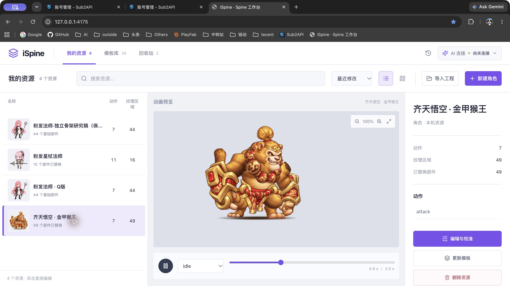

# P7 最终验收

当前状态：P0–P7 实施与本地验收完成，正式工作台已安装并运行。记录日期：2026-10-21。

## 实现与验证

| 范围 | 结果与证据 |
| --- | --- |
| 确定性主测试 | 573/573；[日志](main-tests.log) |
| 架构、隔离、Sites 与角色回导 | 19/19；[日志](support-tests.log)。最新架构规则 4/4，禁止依赖、循环、平台访问和临时例外均为 0 |
| Python 网关本地检查 | 7/7；[日志](python-tests.log)；未访问真实上游 |
| 默认/旧协议浏览器 | 33/33；[日志](browser-v1.log) |
| 格式 2 浏览器 | 33/33；[日志](browser-v2.log)，包含真实下载/文件选择回导与跨上下文重启 |
| 内容计算对照 | 38 个真实模板、像素校准、加权骨架与动作、附件变体及三种 ZIP 与 P2 抽取前结果完全相同；[结果](engine-final.json) |
| 格式转换及回退 | P5 已在真实数据一致性副本验证 21 条记录、6 工程 × 3 格式共 18 组 ZIP 前后逐字节一致及全部实际回导，反向转换保留激活后的编辑；[证据](../architecture-p5-migration/verification.json) |
| 任务生命周期 | 原子持久化后入队、两个独立队列、所有在途取消、关闭等待迟到 turn/start 及 interrupt/unsubscribe 回执。真实 67 条历史在副本加载/关闭后字节不变；[P6 证据](../architecture-p6/verification.json) |
| 静态构建 | 独立目录完整构建，Sites 三个必需产物存在；已安装页面保持打开跨替换后可导出，刷新读取最新 HTML |
| 文件和用户资料 | 623 个受保护文件不变；生成历史、迁移、旧库等六个范围 1366 个文件的摘要一致；14 张生产表字节指纹不变。[保持核对](preservation.json) |

浏览器的 33 项检查覆盖模板临时草稿、保存合并与未知回执、双页冲突另存、回收站恢复和显式永久删除确认、墓碑阻止旧迁入、独立模板生命周期、source-only 草稿、部件与关节拖动撤销、相机保持、窄屏导航、假 provider 候选及跨资源/过期几何拒绝、三种真实 ZIP 下载回导、后台不可用与重启后的跨上下文读取。格式 1 的回执恢复与协议转换用例显式固定各自模式，不能理解为每项都只使用全局选择的协议。

## 性能

固定种子的代表性组合为 10/100/500 条 × 1 MiB、10 条 × 10 MiB、1 条 × 50 MiB；每项列表预热后 30 次，冷启动独立记录。使用同一台 Mac，运行负载与单次重图像测量存在波动；结果是实测样本，不是所有工程的保证。

- 500 条列表 p95 从 P0 的 2384.47 ms 降至格式 2 的 1.11 ms；所有列表样本读取源 payload/BLOB 次数为 0。[原始性能](workspace-v2-performance.json)
- 单次校准或改名提交为 812–819 字节，未变素材上传为 0；50 MiB 合成资源校准保存约 332 ms。后台仍还原记录执行完整领域校验，未宣称保存免读 BLOB。
- 50 MiB 分块上传约 308 ms，期间 status p95 4.43 ms，最大 180.80 ms，事件循环最大 178.78 ms；同步入库约 109.47 ms。仍存在短暂阻塞，未来若需要更严格响应预算，可据此独立评估数据库 Worker。
- 重复素材仅保存一份，引用和上传租约阻止过早回收；过期无引用素材的逻辑回收通过。数据库文件/WAL 大小不表示立即释放磁盘空间。
- 实际 84,801,790 字节可编辑工程在隔离浏览器导入/校准，Worker 输出改用转移后，单次最大长任务由 166 ms 降至 64 ms；仍有超过 50 ms 的长任务，不能声称全部交互无阻塞。[调整前](browser-heavy-before.json)、[调整后](browser-heavy-after.json)

## 验收边界

本轮没有发送真实 AI 请求、解锁已保存网关密钥或审计上游账号。外部 provider 的真实生成、网关渠道和人工角色美术质量仍需对应创作任务验收。官方 Spine 编辑器与 Unity 工程未运行，不能把运行时解析和 ZIP 回导视为官方编辑器接受。工作台仍保留显式 provider 选择，不自动回退；重启后的已保存密钥保持锁定。

回退必须备份当前数据并按 [版本 2 维护流程](../../workspace-v2-protocol.md#检查点迁移与维护)保留新编辑，不允许用迁移前旧库覆盖当前工作区。完整源代码、旧构建与数据备份的位置记录在最终安装证据中。工作区改动尚未提交 Git。

## 正式安装

最终完整构建在独立目录产生并验证后，于停止登录服务期间整体替换；162 个产物逐文件校验，包含 Sites 所需的 `dist/client/index.html`、`dist/server/index.js` 与 `dist/.openai/hosting.json`。保留历史资源包 Worker 文件供已打开页面调用；隔离演练确认旧页面跨构建和服务重启后仍能实际导出，刷新后读取新 HTML。未保留旧主入口参与当前加载。

完整备份位于 `~/Library/Application Support/iSpine Backups/20261021-053038-architecture-complete`：1183 个持久文件、旧构建、当前源代码和单独 SQLite 一致性备份。SQLite 临时 WAL/SHM 不作为独立恢复内容；原库离线复制且另有一致性备份。重启后仅工作台运行日志新增，用户资料保持。迁移前备份仍单独保留。

登录服务恢复后，4175、4173、4180 均返回原工作区身份及 revision 4；仍有 4 个正常资源、2 个回收站资源、7 个永久删除墓碑、3 份独立草稿和 1 个自建模板，67 条生成任务均处于原终态，未自动重做。当前 Sub2API 选择及原密文保留，重启后保持锁定。Chrome 已刷新到最终版本，原悟空资源的 49 个替换区域和真实动画预览正常。[安装核对](production-activation.json)、[完整构建清单](build-manifest.json)、[缓存页面演练](cached-build.json)。

