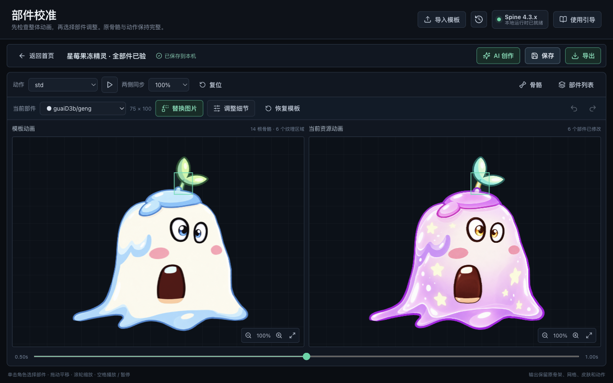

# 星莓果冻精灵：蛋仔全角色生成与验收

2026-10-19。基于工作台中 **蛋仔模板 19**（带双叶的果冻角色），使用当前 Codex 账号的原生生图完成。全部 **6/6** 纹理区域重新生成、替换并逐件校准，全部 **5/5** 动作验证通过，没有积分逻辑。

## 文件

- [Spine 4.3 运行包](starberry-runtime.zip)：骨架、Atlas、完整新贴图，直接包含全部新角色部件。
- [可编辑工程](starberry-project.zip)：原模板、全部生成部件、六份校准、形象参考与提示词。
- [重新导入后再次导出的运行包](starberry-reimport-runtime.zip)、[重新导入后再次导出的工程](starberry-reimport-project.zip)。
- [形象参考](appearance.png)、[全部六块透明 PNG](parts/)、[实际提示词](prompts.json)、[生成来源和图片校验值](generation.json)。
- [机器可读验收结果](validation.json)、[浏览器姿势记录](evidence/browser-poses.json)、[逐像素比对](evidence/render-comparison.json)。

## 全部部件

| 部件 | 模板逻辑尺寸 | X / Y 校准 | 缩放 | 导出裁切损失 |
| --- | --- | --- | --- | --- |
| [茎 geng](parts/geng.png) | 75 × 100 | -2.43 / -5.97 | 127.99% | 0 像素 |
| [双叶 hua](parts/hua.png) | 175 × 150，Atlas 旋转 90° | -1.03 / -11.31 | 100.07% | 0 像素 |
| [网格身体 sehnti](parts/sehnti.png) | 685 × 590 | -1.76 / 7.68 | 99.09% | 0 像素 |
| [眼 yan1](parts/yan1.png) | 70 × 110 | -2.86 / -1.54 | 125.91% | 0 像素 |
| [眼 yan2](parts/yan2.png) | 90 × 135 | -0.65 / 0.64 | 112.73% | 0 像素 |
| [嘴 zui](parts/zui.png) | 260 × 170 | -10.66 / 6.47 | 106.20% | 0 像素 |

每块均在「调整细节」中按模板轮廓适配、查看叠图后完成调整；[六块校准截图与参数](evidence/calibration.json)。身体没有混入五官；眼、嘴、茎和叶保持独立。全部原骨骼、加权网格、UV、动画和绘制顺序保留。

## 全部动作与实际重导入

每个动作检查起始、中段、后段三个关键帧，分别在导出前、运行包重导入、可编辑工程重导入后执行，共 **45 个浏览器关键帧**。下表链接到各动作的中段完整截图；起始和后段截图也保存在 `evidence/`。

| 动作 | 导出前 | 运行包重导入 | 工程重导入 |
| --- | --- | --- | --- |
| atk | [查看](evidence/before-export-atk-middle.png) | [查看](evidence/runtime-import-atk-middle.png) | [查看](evidence/project-reimport-atk-middle.png) |
| jifei | [查看](evidence/before-export-jifei-middle.png) | [查看](evidence/runtime-import-jifei-middle.png) | [查看](evidence/project-reimport-jifei-middle.png) |
| std | [查看](evidence/before-export-std-middle.png) | [查看](evidence/runtime-import-std-middle.png) | [查看](evidence/project-reimport-std-middle.png) |
| std2 | [查看](evidence/before-export-std2-middle.png) | [查看](evidence/runtime-import-std2-middle.png) | [查看](evidence/project-reimport-std2-middle.png) |
| walk | [查看](evidence/before-export-walk-middle.png) | [查看](evidence/runtime-import-walk-middle.png) | [查看](evidence/project-reimport-walk-middle.png) |

- 每帧两侧的动画时间和姿势值一致；30 组重导入后的角色画布与导出前 **逐像素相同**。
- 每个动作采样 **121 个时刻**，共 **605 个姿态对照**，导出前后及重导入后的全部 region / weighted-mesh 顶点一致且有效。
- 全部六块贴图实际发生变化；选中 Atlas 区域之外变化 **0 像素**，六块校准后被 Atlas 裁掉的可见像素均为 **0**（alpha > 8）。
- 实际使用浏览器文件选择器重新导入下载的运行包和工程，六份校准及形象参考、两类提示词完整恢复。运行包已经烘焙，所以重导入运行包后显示「0 个部件已修改」；它的原始贴图本身就是完整新角色。
- 首次导出的新角色运行包和工程重导入后再导出的运行包，大小均为 **452,122 字节**，SHA-256 均为 `4d00fb45f5b9360906e801b05cdc8b70d1dedee05f930bfe67c82a9cdffcd376`。
- `pnpm test:egg`：**9 / 9 通过，0 跳过**，测试不会自动调用生图服务。

验证范围为当前工作台和匹配的 Spine 4.3 运行库；尚未进行外部游戏引擎集成验收。原参考模板的来源说明沿用 [素材记录](../../docs/reference-assets.md)。
