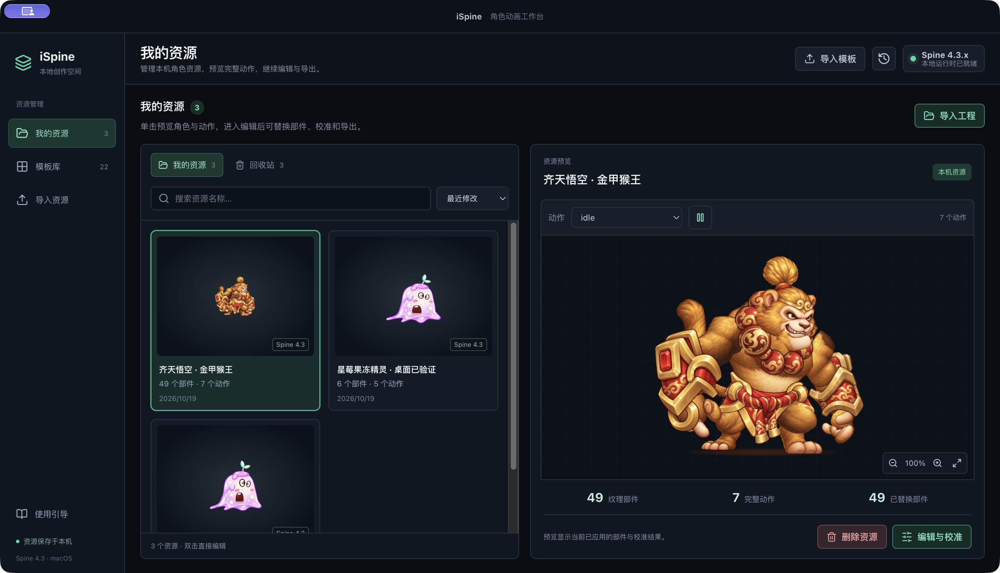

# 齐天悟空 · 金甲猴王

金棕猴毛、金色头箍、红金护甲与腰带的悟空角色。角色使用功夫熊猫模板的完整骨架，49 个纹理区域均由软件内连接的 Codex 原生生图流程重新绘制，保留 145 根骨骼、143 个附件引用和 2 个皮肤。

## 使用

在 iSpine 的「导入资源」中选择 `wukong-project.zip`，可以继续调整全部替换图片、校准参数和形象参考。`wukong-runtime.zip` 包含 JSON 骨架、Atlas 与烘焙后的 PNG，可供匹配 Spine 4.3.x 的运行库使用。

## 文件

- `wukong-project.zip`：完整可编辑工程，约 85 MB。
- `wukong-runtime.zip`：完整运行时资源，约 2.3 MB。
- `appearance.png`：导入工作台的角色形象参考。
- `parts/`：49 个原生生图结果，包含动作切面、面部、四肢、服饰和阴影区域。
- `generation.json`、`prompts.json`：模板指纹、部件对应、批次、提示词与文件校验值。
- `calibration.json`：每个区域的校准参数、轮廓重合和边界检查。
- `validation.json`、`evidence/`：完整角色验收结果与实际界面画面。
- `wukong-reimport-project.zip`、`wukong-reimport-runtime.zip`：重新导入后实际下载的验证副本。

## 验证

49 个区域全部替换、全部可见，校准后没有图集裁切损失。原骨架和 Atlas 字节保留；两个皮肤的 attack、die、get_hurt、idle、reborn、skill、stun 共 1,694 个姿势采样有效。桌面应用逐一检查了 14 个皮肤与动作组合；浏览器检查 126 个同步姿势，84 组往返画面对比逐像素一致。

运行时和可编辑工程各自重新导入、再次导出后，ZIP 文件均与原导出文件字节一致。受击红闪、技能残影及复活动作保留模板中的原有表现。

部件生图使用工作台内的托管 Codex 账号，最后 14 个部件以 3 张并行生成，实际最大同时进行数为 3。形象参考使用内置 imagegen 生成后，通过工作台的「导入形象」设置。生成结果导入时统一编码为 PNG，解码像素与生成原图一致；工程备份保留规范化后的图片及完整校准。
